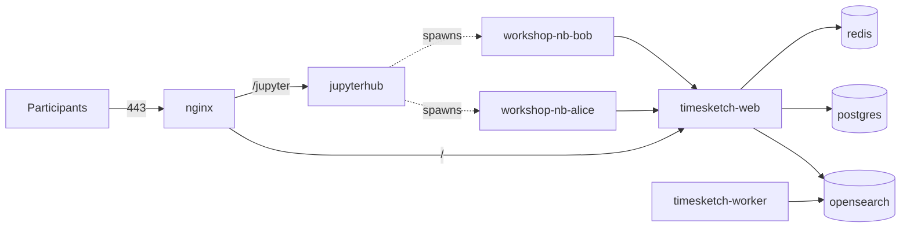

# MAGIC Workshop Environment

Docker Compose environment for a hands-on workshop on
[MAGIC](https://github.com/SVA-Cybersecurity/magic) (Microsoft Azure Graph
Information Crawler).

Every participant gets:

- a personal **Timesketch** account and their own sketch,
- a personal **JupyterHub** account that spawns an isolated notebook container,
- a notebook pre-wired to their Timesketch account and a MAGIC `config.yaml`
  pre-filled with the shared M365 app credentials.



Participants reach Timesketch at `https://<host>/` and JupyterHub at
`https://<host>/jupyter/`. Notebook containers talk to Timesketch directly over
the internal Docker network, so TLS and basic auth never interfere with the API
client.

---

## Prerequisites

- Ubuntu host (tested target: EC2) with Docker Engine and the Compose plugin
- 8 vCPU / 32 GB RAM for ~10 participants
- Inbound TCP 80 and 443 open in the security group
- An Entra ID app registration for MAGIC (client id, client secret, tenant id)

---

## One-time setup

Run everything from the repository root on the Docker host.

### 1. Clone and bootstrap

```bash
git clone <repo-url> /opt/magic-workshop
cd /opt/magic-workshop
make bootstrap
```

`make bootstrap` creates `.env` from `env.example` (generating the Postgres and
Timesketch admin passwords), creates the runtime directories, downloads the
stock Timesketch config files and patches them. It is safe to re-run.

### 2. Fill in `.env`

Edit at minimum:

| Variable | Notes |
|---|---|
| `PUBLIC_HOSTNAME` | DNS name or IP; becomes the TLS certificate CN |
| `MAGIC_CLIENT_ID` | Entra ID application (client) id |
| `MAGIC_CLIENT_SECRET` | Entra ID client secret |
| `MAGIC_TENANT_ID` | Entra ID tenant id |
| `OPENSEARCH_MEM_USE_GB` | ~half of RAM, minus room for notebook containers |

`WORKSHOP_ROOT` is set automatically to the checkout path. If you move the
checkout, update it — DockerSpawner passes it to the host Docker daemon.

### 3. Kernel setting and certificate

```bash
make sysctl    # vm.max_map_count=262144, required by OpenSearch (uses sudo)
make certs     # self-signed certificate for PUBLIC_HOSTNAME
```

### 4. Build and start

```bash
make build     # JupyterHub image + participant notebook image (MAGIC, TS clients)
make up
make ps        # all services should be running/healthy
```

First start takes a few minutes while OpenSearch initialises.

### 5. Optional: an admin account for yourself

The stack must already be up:

```bash
make ts-admin
```

Creates the `TIMESKETCH_ADMIN_USER` from `.env` and makes it a Timesketch admin,
so you can see all sketches during the workshop. Provisioning does **not**
depend on it — each participant's sketch is created by that participant.

### 6. Optional: HTTP basic auth in front of everything

```bash
make htpasswd AUTH_USER=workshop   # prompts for a password
make restart-nginx
```

Disable again with `make no-htpasswd && make restart-nginx`.

---

## Shared notebook files

Every notebook mounts the same host directory at `/home/jovyan/work/shared`,
visible as `shared` in the JupyterLab file browser. Participants can read files
there, but Docker mounts it read-only. Their personal work directory remains
writable. The workshop operator manages the shared files on the host.

`make bootstrap` creates `shared-data/` with mode `0755`. Set `SHARED_DATA_DIR`
in `.env` to use another directory relative to `WORKSHOP_ROOT`. Existing `.env`
files without this setting automatically use `shared-data`.

For example, run from the deployed workshop directory as the workshop operator:

```bash
install -m 0644 /path/to/dataset.csv shared-data/dataset.csv
```

Use your configured directory instead of `shared-data` if you changed it. Files
must be readable by the notebook user, typically mode `0644`, and subdirectories
must allow traversal, typically mode `0755`. Only publish material intended for
all participants. Host-side file updates become visible without restarting
notebooks.

For an existing deployment, deploy the updated workshop files, run
`make bootstrap`, and recreate the Hub to load its new environment and config:

```bash
docker compose up -d --no-deps --force-recreate jupyterhub
```

Notify participants before stopping and starting their notebook servers through
JupyterHub so they receive the new mount. A kernel restart alone is insufficient;
existing notebook containers keep their old mounts across a Hub restart. The
same stop/start is required after changing `SHARED_DATA_DIR`.

---

## Provisioning participants

### 1. Write the participant list

```bash
cp participants.csv.example participants.csv
```

```csv
username,full_name,email,password
alice,Alice Anderson,alice@example.com,
bob,Bob Brown,bob@example.com,
```

- `username` must match `^[a-z][a-z0-9_-]{1,30}$` and is used for both systems.
- Leave `password` empty to have one strong password generated for both
  Timesketch and JupyterHub.
- A password you set yourself must be at least 12 characters.
  Provisioning writes JupyterHub accounts directly into the database, which
  bypasses NativeAuthenticator's own strength check, so the same minimum is
  enforced here and shorter passwords are rejected.

### 2. Provision

```bash
make provision-dry-run   # optional preview
make provision
```

For each participant this creates the Timesketch account, a sketch owned by
them, `participants-data/<username>/` (MAGIC `config.yaml`, `.timesketchrc`,
`Workshop-Getting-Started.ipynb`, personal README) and the JupyterHub account.

**No restart is required** — participants can log in immediately, and notebooks
already running are not disturbed.

### 3. Hand out credentials

- `participants.generated.csv` — all issued credentials (mode `0600`)
- `handout/<username>.md` — one page per participant with URLs and passwords

Both are git-ignored. Warn participants that the certificate is self-signed, so
the browser will show a warning on first visit.

### Selective and repeat runs

```bash
make provision ARGS="--only carol"          # add one late participant
make provision                              # re-run: passwords are preserved
make provision ARGS="--rotate-passwords"    # force new passwords
```

Re-running is idempotent: existing passwords are reused from
`participants.generated.csv` and existing sketches are reused by name.

### Removing participants

```bash
make deprovision ARGS="--only bob"
```

Disables the Timesketch account, deletes the JupyterHub account, removes the
running notebook container and archives the data directory to
`participants-data/bob.removed`. Nothing is deleted outright. Removal reads
`participants.generated.csv`, so it still works after you delete the row from
`participants.csv`.

---

## Day-to-day operation

```bash
make ps                      # container status
make logs SVC=jupyterhub     # tail one service
make ts-users                # Timesketch accounts
make jh-users                # JupyterHub accounts
make shell-ts                # shell in the Timesketch container
make down                    # stop everything, keep all data
make up                      # bring it back
```

`make help` lists every target.

---

## Teardown

```bash
make down                                  # stop, keep data
docker compose down -v                     # also drop the JupyterHub volume
sudo rm -rf data participants-data handout certs config/timesketch
```

Then terminate the instance.

---

## Security notes

This is a short-lived training environment, not a hardened deployment.

- The JupyterHub container mounts `/var/run/docker.sock`, which is effectively
  root on the host.
- Each participant's Timesketch password is written in clear text into their
  notebook and `handout/` page. Deliberate, so the notebook works with no login
  step.
- TLS uses a self-signed certificate; notebooks bypass it via the internal
  network.
- Self-service signup is disabled. Logins are gated on NativeAuthenticator's
  `users_info` table, which only the provisioning script writes to.
- All participants share one M365 app registration, so they share its Graph
  permissions and API throttling budget.

Everything secret is git-ignored: `.env`, `participants*.csv`, `handout/`,
`certs/`, `config/timesketch/`, `participants-data/`, `config/nginx/htpasswd`.
Verify before publishing with:

```bash
git status --short
git check-ignore -v .env handout participants.generated.csv
```

---

## Repository layout

```
docker-compose.yml          the whole stack
env.example                 configuration template -> .env
participants.csv.example    participant list template
Makefile                    all operator commands
config/nginx/               nginx.conf + basic-auth toggle
config/jupyterhub/          jupyterhub_config.py
config/timesketch/          fetched + patched by make bootstrap (git-ignored)
images/jupyterhub/          hub image
images/singleuser/          participant notebook image (MAGIC + TS clients)
provisioning/provision.py   CSV -> accounts, sketches, notebooks
provisioning/templates/     notebook, MAGIC config, handout templates
scripts/                    bootstrap, certificate and htpasswd helpers
```
